<!-- Animated header -->

<!-- Animated profile card (switches with GitHub light/dark theme) -->
<picture>
  <source media="(prefers-color-scheme: dark)" srcset="./dark.svg">
  <source media="(prefers-color-scheme: light)" srcset="./light.svg">
  
</picture>

<!-- Typing animation -->

---

## 👨‍💻 About Me

I am a skilled **Full Stack Web Developer** who builds complete web applications, from responsive user interfaces to the server-side logic and databases behind them. I'm ambitious, enthusiastic, focused, organized, and easy to work with.

- 🔭 I'm currently working on **exciting full stack projects**
- 🌱 I'm currently learning **new technologies and best practices**
- 👯 I'm looking to collaborate on **open-source projects**
- 💬 Ask me about **web development**
- 🌐 My resume site: [samiul-alam-rabbi.netlify.app](https://samiul-alam-rabbi.netlify.app/)
- 📫 How to reach me: [developersamiulalam@gmail.com](mailto:developersamiulalam@gmail.com)
- ⚡ Fun fact: **add something fun about yourself**

---

## 🛠️ Tech Stack

**Frontend**

**Backend & Database**

**Tools**

> ✏️ Edit the icon lists to match your real stack. Icon names are listed at [skillicons.dev](https://skillicons.dev).

---

## 📊 GitHub Stats

---

## 🏆 Trophies

  

---

## 🤝 Connect With Me

